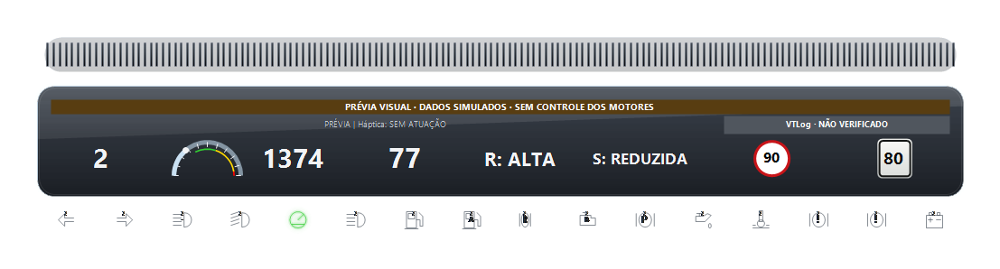

# Scania Haptics

Telemetria, HUD e feedback háptico para Euro Truck Simulator 2. Aplicativo Windows independente desenvolvido por **Samuel Silva Sardinha**.

**Versão atual: v2.3.0 RC11.20 — App 2.3.0.20, gerenciador 2.3.0.17 e DLL 2.3.0.12. Pré-lançamento para validação.**

[Baixar RC11.20](https://github.com/samuelssardinha/Scania-Haptics/releases/tag/v2.3.0-rc11.20) · [Guia de uso](docs/GUIA_ATUAL.md) · [Novidades e imagens](docs/RC11_20.md) · [Perfis](docs/IMPORTAR_EXPORTAR_PERFIS.md) · [Validação](docs/VALIDACAO.md)

## Abrir a RC11.20

1. Baixe o instalador `Scania_Haptics_RC11_20_Setup_x64.exe` ou o portátil e confira o SHA256 da mesma release.
2. Feche a versão anterior, inclusive pela bandeja. Extraia o ZIP inteiro em uma pasta nova e abra `ScaniaHaptics.exe`.
3. O aplicativo é autocontido Windows x64: não exige instalar .NET separadamente. O portátil usa a mesma instância única e as preferências da instalação existente.
4. Exporte sua configuração em **Importar / Exportar / Perfis** antes de aplicar novos padrões. Para configurar a DLL opcional, feche o ETS2 e use o gerenciador incluído.

Instalador e portátil incluem a mesma RC11.20. Consulte [instalação, atualização e perfil inicial](docs/INSTALAR_RC11_20.md). A DLL não é copiada para o jogo automaticamente.

## Novidades

- Quatro novos materiais: **Glass Clear, Liquid Glass, Frosted Neon e Dark Glass Pro**.
- Paletas independentes para HUD, F9 e aplicativo, ou tema unificado; cantos, raio, borda e iluminação configuráveis por interface.
- Prévia local com o mesmo caminho de composição da HUD, reduzida proporcionalmente, incluindo painel e régua.
- Perfil inicial **Meu cockpit**, com os ajustes visuais do autor, tema Nordic Light e régua de 150 LEDs. Conexão automática da manopla/G923; motores no **Nível 0** até validação da montagem. Preferências existentes são preservadas.
- F9 organizado em Operação, HUD e luzes, Aparência; transparência/brilho globais, ajustes locais e intensidade dos efeitos.
- Simulação completa e cenários: jogo/telemetria real têm prioridade; minimizar/ocultar encerra o simulador; retorno à simulação exige novo início explícito.
- Mostradores analógicos opcionais inspirados no 113H para temperatura da água e pressão de ar dos freios, com modo digital preservado.
- Exportação/importação completa em JSON versionado, com validação, relatório, backup verificado e restauração.
- Instrumentos, efeitos hápticos, editor desktop, placas, LEDs G29/G923, bandeja e protocolos anteriores preservados.

As imagens são geradas com dados e transportes simulados. Os materiais usam reflexos vetoriais; não capturam nem desfocam o jogo.

## Downloads desta release

| Arquivo | Conteúdo |
|---|---|
| `Scania_Haptics_RC11_20_Setup_x64.exe` | Instalador Windows x64 com backup e verificação |
| `Scania_Haptics_RC11_20_Portavel_win-x64.zip` | Aplicativo, runtime, gerenciador, DLL opcional e avisos de terceiros |
| `Scania_Haptics_RC11_DLL_x64.zip` | DLL opcional x64 e avisos |
| `Scania_Haptics_Icones.zip` | Ícones do projeto |
| `Scania_Haptics_Documentacao.zip` | Documentação e capturas simuladas |
| `SHA256SUMS.txt` | Hashes de todos os downloads |

**305 grupos aprovados, zero falhas finais.** Testes no ETS2 e nos dispositivos reais continuam pendentes; consulte a [validação](docs/VALIDACAO.md).

Este repositório distribui **binários, documentação e imagens**. Os fontes originais permanecem privados. Os arquivos automáticos “Source code” do GitHub contêm somente este conteúdo público.

## Limites e créditos

A simulação pode acionar dispositivos habilitados/conectados. Ela não certifica motores ou LEDs físicos. Pista é estimada pela telemetria; não lê o force feedback do volante. Canais ausentes são indicados como indisponíveis. Motor em paralelo acompanha seu canal físico e não tem controle independente. Não há firmware ou atualizador USB nesta distribuição.

Código original proprietário, com distribuição gratuita autorizada pelo autor. A licença incluída permanece identificada como minuta; componentes de terceiros mantêm suas licenças e avisos. Nenhuma licença aberta foi aplicada aos fontes originais.

Projeto independente e não oficial, sem afiliação, patrocínio ou endosso de Scania, SCS Software, Logitech ou demais fabricantes citados. As marcas pertencem aos respectivos titulares.

Copyright © 2026 Samuel Silva Sardinha. [Contato público](https://wa.me/5571996973010).

