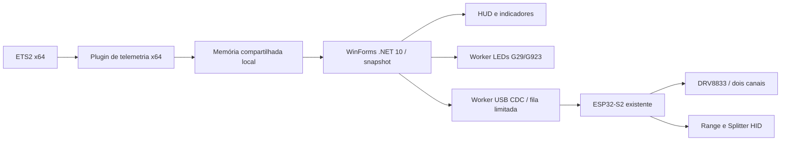

# Guia da versão atual

Referência: publicação de 14/11/2026, RC11 Completa, App/gerenciador 2.3.0.17, DLL 2.3.0.12. A pasta histórica v2.2.12 do projeto não indica a versão do aplicativo atual.

## Componentes e dados



A DLL registra canais do SDK SCS e publica dados em mapas locais de memória; o App confere validade e mantém um snapshot para seus módulos. A serial tem um único proprietário, evitando acesso concorrente à COM. Os seletores HID funcionam sem depender do App. A DLL e o firmware têm números de protocolo independentes da versão comercial.

## Instalação, atualização e restauração

O instalador destina-se ao Windows 11 x64, sem necessidade de instalar .NET separadamente. Use uma conta com acesso de escrita à pasta escolhida. Os arquivos ficam por padrão em `%LOCALAPPDATA%/Programs/ScaniaHaptics`; as preferências ficam em `%LOCALAPPDATA%/ScaniaHaptics/config.json`.

Encerre App, observador e gerenciador antes de atualizar. O setup bloqueia arquivos em uso, preserva configurações e cria backups verificados dos arquivos substituídos em `InstallerBackups`. Não encerra seus processos à força. Abrir o App ou configurar o plugin no fim é opcional.

Para instalar a DLL, feche o ETS2 e use o gerenciador. O destino é exclusivamente `bin/win_x64/plugins/scania_haptics_v2.dll` na raiz escolhida. Arquivos em Program Files podem exigir permissão de escrita. Não copie plugins com o jogo aberto. Para rollback, use a restauração oferecida pelo gerenciador; não substitua outros plugins.

Para retornar o App, feche-o e restaure o backup ou reinstale a entrega anterior. Preserve também uma cópia privada de `config.json` e `.bak` se quiser restaurar exatamente suas preferências. Desinstalação preserva dados por padrão; a remoção explícita é limitada aos dois arquivos conhecidos. A DLL do jogo é gerenciada separadamente.

## Aplicativo

As páginas agrupam operação, motores/testes, dispositivos e HUD. A HUD permite ativação, legenda, fonte e formato individual, layouts, escala, alinhamento e ordem. Componentes desligados deixam de reservar espaço. Arrastar/trocar/remover componentes é uma operação do editor no desktop; a visualização durante o jogo não deve capturar controles indevidamente.

Os ajustes gráficos não alteram marcha/transmissão do jogo. Cruise, retarder, pressões e indicadores dependem de canais válidos; não se inferem ABS/TCS ou níveis ausentes. A simulação oferece valores sintéticos e pode comandar dispositivos, conforme as opções de atuação. Ela não comprova recepção do ETS2.

Fechar para a bandeja e inicialização automática são preferências. Restaure pelo menu da bandeja ou pelas opções/hotkeys configuradas; para atualizar, escolha sair completamente. A proteção de instância única evita execução concorrente normal. O instalador não ativa AutoStart por conta própria; o App respeita preferências anteriores quando aberto.

O módulo Logitech tem worker e transporte próprios. Controle de LEDs não é leitura de force feedback. Não use resultado de simulação como homologação de G29/G923 físico.

## Hardware existente

| Função | GPIO |
|---|---:|
| Range / Splitter | 1 / 2 |
| DRV8833 canal A IN1 / IN2 | 9 / 10 |
| DRV8833 canal B IN3 / IN4 | 8 / 4 |

GPIO10 corresponde ao firmware; continuidade da solda deve ser confirmada, pois há desenho antigo indicando GPIO11. Não trocar pinagem com base nesse desenho. Um motor de 3 V em paralelo ao canal B acompanha PWM e polaridade desse canal. SWAP muda os papéis lógicos, sem criar um terceiro canal.

PWM é de 1 kHz e 8 bits. A montagem não fornece medição de corrente/temperatura ao software. Validar tensão, corrente de partida/travamento, proteção, dissipação e estados de boot; duty reduzido não torna uma fonte de tensão maior automaticamente adequada ao motor de 3 V. Manter corte físico de alimentação acessível. Ensaios elétricos estão pendentes.

## Firmware e serial

O firmware existente anuncia v2.2.12 e usa ESP32-S2/TinyUSB com HID e CDC. Não acompanha este pacote e não será gravado por ele. USB, pinagem e protocolos não foram alterados na preparação para GitHub.

Serial ASCII a 115200, um comando por linha CR/LF. STATUS informa capacidades; BASE1/CAL1 são negociados e não devem ser enviados a versões que não os anunciam. Consulte a [referência serial](PROTOCOLO_SERIAL.md) e a [extensão de base/calibração](RC1_4_BASE_CALIBRACAO.md) para sintaxe, argumentos, respostas e limites.

MTEST/DUAL isolam testes, com PWM direto e duração limitada; desligam geração contínua e exigem retomada por ENGINE ON válido. STOP/timeout mantêm a parada e o isolamento. LEVEL 0 bloqueia saída, mas não é uma proteção elétrica independente. O watchdog do firmware usa atividade válida; consultas STATUS não o renovam. Não execute testes de PWM alto numa montagem sem limites validados.

## DLL e contratos

Exports x64: `scs_telemetry_init` e `scs_telemetry_shutdown`. V1/V2/V3 têm 24/48/108 bytes, little endian, com prefixos preservados. V4.1 usa mapa separado de 384 bytes, guarda de sincronismo, identidade da publicação e validade por campo. Signals1, Jobs1, Indicators1, Instruments1 e Vehicle1 são extensões opcionais. Vehicle1 tem 256 bytes, permitindo pressão/temperatura e estados específicos; ausência de extensão não impede o App de apresentar os dados antigos.

Referências completas de offsets e sincronismo: [V4](PROTOCOLO_TELEMETRIA_V4.md), [Signals1](PROTOCOLO_SIGNALS1.md), [Jobs1](PROTOCOLO_JOBS1.md), [Indicators1](PROTOCOLO_INDICATORS1.md), [Instruments1](RC1_4_1_PROTOCOLO_INSTRUMENTS1.md), [Vehicle1](PROTOCOLO_VEHICLE1.md). A validade individual de RPM/ENGINE é exigida na V4 antes de liberar telemetria háptica.

## Compilação e distribuição

Os fontes originais são privados; este repositório público não permite reconstruir o App/DLL por si só. No workspace privado: SDK .NET 10.0.403 fixado por global.json, runtime e System.IO.Ports 10.0.14, MSVC C++17 x64 e Inno Setup 6.7.4. O builder completo é `tools/Preparar_RC11_Completa.ps1`, com snapshot commitado, destinos novos e locks do compilador. Ele publica Release win-x64 autocontido, compila DLL `/MT` com recurso de versão e verifica PE, manifestos e retornos.

O script antigo COMPILAR_DLL.bat não é a receita exata desta release: não inclui o recurso de versão nem explicita `/MT`. Scripts de build e instalação têm finalidades diferentes; não execute instaladores para verificar compilação. Nenhum SDK, compilador ou firmware binário integra os downloads públicos.

## Verificação e problemas comuns

```powershell
Get-FileHash .\Scania_Haptics_RC11_Completo_Setup_x64.exe -Algorithm SHA256
```

Compare o resultado com SHA256SUMS.txt baixado da mesma release. A versão não é assinada digitalmente. Os testes e suas limitações estão em [VALIDACAO.md](VALIDACAO.md).

| Sintoma | Conferir |
|---|---|
| Sem telemetria | ETS2 x64, plugin no destino correto, jogo reiniciado após instalação, versões e validade dos canais |
| COM ocupada | Fechar outra instância, monitor serial ou ferramenta de gravação; não forçar reinstalação do dispositivo |
| Motor parado | LEVEL, seleção de canal, STOP/isolamento, necessidade de retomar, dados vencidos e alimentação |
| Nome TinyUSB HID no joy.cpl | Nome USB e nome OEM do Windows são distintos; esta publicação não altera Registro nem driver |
| Campo indisponível | Canal opcional ausente ou sem validade; não substituir por estado inventado |
| Janela na bandeja | Restaurar pelo menu; para atualizar, encerrar também o observador |

Não foram executados nesta preparação: ETS2 real, instalação pessoal, alteração de Registro, firmware/bootloader, motores, LEDs físicos ou medições elétricas. Relatos anteriores e testes sintéticos não substituem esses ensaios.
