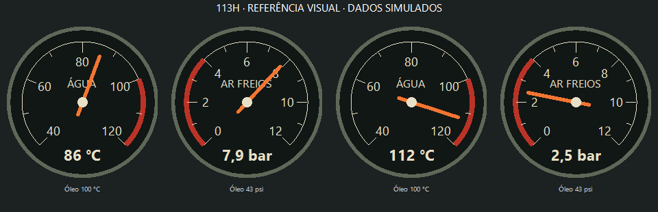

# RC11.20 — Glass, simulação e perfis

App 2.3.0.20; gerenciador 2.3.0.17; DLL 2.3.0.12. Candidata com instalador e portátil Windows x64.

## Temas e geometria

Glass Clear usa cristal neutro e reflexão ampla; Liquid Glass usa curvas de reflexão e luz difusa; Frosted Neon combina brilho ciano/violeta e textura sutil; Dark Glass Pro oferece fundo escuro para leitura prolongada. Os estilos anteriores continuam disponíveis.

As paletas podem ser unificadas ou escolhidas separadamente para aplicativo, F9 e HUD. O seletor de geometria permite Global/HUD/F9/aplicativo: cantos retos/arredondados, raio 0–200%, borda ligada/desligada, espessura 1–6 e opacidade 0–100%. Alto contraste do Windows tem prioridade. Campos de entrada permanecem sólidos para leitura.

As superfícies da HUD têm alpha por pixel; no F9, a translucidez da janela é opcional. No aplicativo, vidro é desenhado sobre fundos próprios. Não há captura ou desfoque do jogo/desktop.

## HUD, prévia e F9

A prévia da HUD usa a composição real reduzida proporcionalmente, incluindo painéis, régua, fontes, bordas e transparência. Avisos essenciais permanecem visíveis. Se o espaço físico não comportar todos os instrumentos, o aviso existente informa a limitação.

Na primeira execução sem configuração nem backup, Meu cockpit aplica os ajustes visuais do autor, incluindo Nordic Light e régua de 150 LEDs. Conexão automática fica habilitada, motores no Nível 0. A restauração completa explícita continua usando Dark Glass Pro, régua de 150 LEDs, legendas ocultas e Alt+A. Contagem, legendas e atalho são configuráveis. O atalho exige HUD habilitada. Preferências já salvas continuam respeitadas; restaurar somente a HUD conserva o atalho atual.

F9 mantém o cursor próprio e o comportamento passivo, com grupos Operação, HUD e luzes, Aparência. Brilho e transparência globais afetam toda a composição; painel e régua mantêm controles locais. A intensidade geral modula os efeitos decorativos.

## Simulação

O simulador está acessível na visão geral e no grupo Simulação. Oferece ciclo completo de 60 s, controle manual, cruise, retarder/freio motor, pista, diferencial/eixos, avisos/excesso de velocidade e partida.

Início exige ação explícita e é bloqueado com jogo ativo, telemetria fresca ou detecção incerta. A fonte real tem prioridade. Na transição, os eventos sintéticos, estados e overrides são limpos; STOP manual e handshakes continuam valendo. Minimizar, ocultar ou fechar encerra o simulador. Fechar o jogo não reinicia a simulação automaticamente.

Os transportes físicos existentes são reutilizados; dispositivos precisam estar habilitados e conectados. Operação nativa já em andamento continua sujeita ao driver. OFF físico requer homologação em hardware.

## Perfis e navegação

O menu agrupa visão geral, volante/dispositivos, manopla/controle háptico, HUD, alertas/sons, simulação, aparência, perfis e diagnóstico. Os mesmos controles e bloqueios operacionais foram reaproveitados.

**Importar / Exportar / Perfis** inclui todas as preferências, valida o JSON, relata incompatibilidades e cria backup verificado antes da gravação atômica. A importação não inicia simulação nem reativa dispositivos. Veja o [guia de perfis](IMPORTAR_EXPORTAR_PERFIS.md).

## Capturas simuladas

| Material | HUD | Aplicativo | F9 | Prévia local |
|---|---|---|---|---|
| glass-clear | [Imagem](../assets/rc11.20/glass-clear-hud.png) | [Imagem](../assets/rc11.20/glass-clear-app.png) | [Imagem](../assets/rc11.20/glass-clear-f9.png) | [Imagem](../assets/rc11.20/glass-clear-preview.png) |
| liquid-glass | [Imagem](../assets/rc11.20/liquid-glass-hud.png) | [Imagem](../assets/rc11.20/liquid-glass-app.png) | [Imagem](../assets/rc11.20/liquid-glass-f9.png) | [Imagem](../assets/rc11.20/liquid-glass-preview.png) |
| frosted-neon | [Imagem](../assets/rc11.20/frosted-neon-hud.png) | [Imagem](../assets/rc11.20/frosted-neon-app.png) | [Imagem](../assets/rc11.20/frosted-neon-f9.png) | [Imagem](../assets/rc11.20/frosted-neon-preview.png) |
| dark-glass-pro | [Imagem](../assets/rc11.20/dark-glass-pro-hud.png) | [Imagem](../assets/rc11.20/dark-glass-pro-app.png) | [Imagem](../assets/rc11.20/dark-glass-pro-f9.png) | [Imagem](../assets/rc11.20/dark-glass-pro-preview.png) |

Fixtures com dados e transportes simulados; não são capturas de uma sessão real de ETS2. A prévia local aparece reduzida; a imagem HUD representa a composição do renderizador. A captura de formulários por bitmap não certifica toda combinação de desktop, monitor ou DPI real.

## Verificação

Regressão repetida após incorporar o perfil inicial; resultados na matriz de validação. [Matriz e limites](VALIDACAO.md). DLL, firmware, pinagem, protocolos e dependências preservados nesta rodada. Instalador RC11.20 incluído; sem promoção para Stable.

## Mostradores analógicos 113H

Nas abas individuais Temperaturas de água/óleo e Pressões de ar/óleo, escolha Gráfico → Analógico · Scania 113H. Selecionar o gráfico ativa o modo visual daquele componente. Digital mantém a leitura anterior; escolher Somente texto/dígitos depois oculta o gráfico sem apagar sua preferência.

Mostradores vetoriais originais inspirados no 113H, com ponteiro, escala clara, fundo escuro e faixas vermelhas de referência. Água em °C (40–120 na escala); ar dos freios em bar (0–12 na escala), convertido dos psi fornecidos por Vehicle1. Os valores reais fora da escala continuam no número; o ponteiro fica no extremo. As faixas desenhadas não são calibração oficial nem alteram os avisos reais do veículo. Só há uma pressão de ar disponível; não são inventados dois circuitos. Sem sinal válido não há ponteiro e o valor é —. Óleo continua na linha inferior. Área pequena usa texto compacto. Ajustes de fonte e alinhamento continuam individuais.

